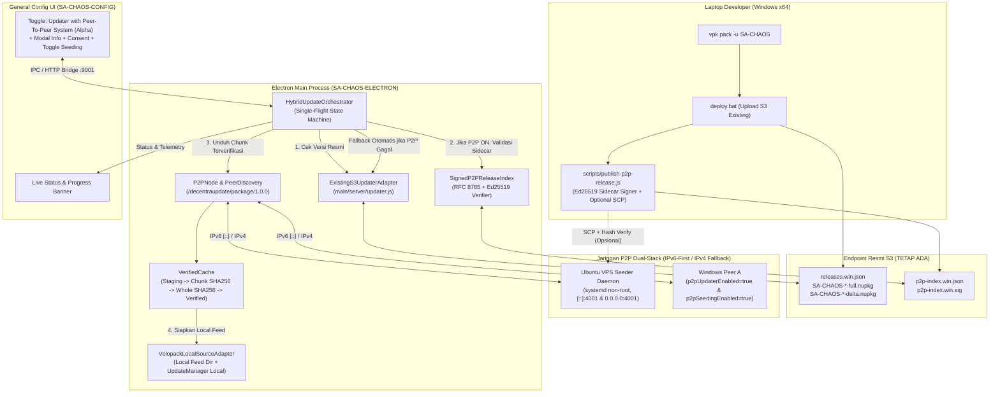
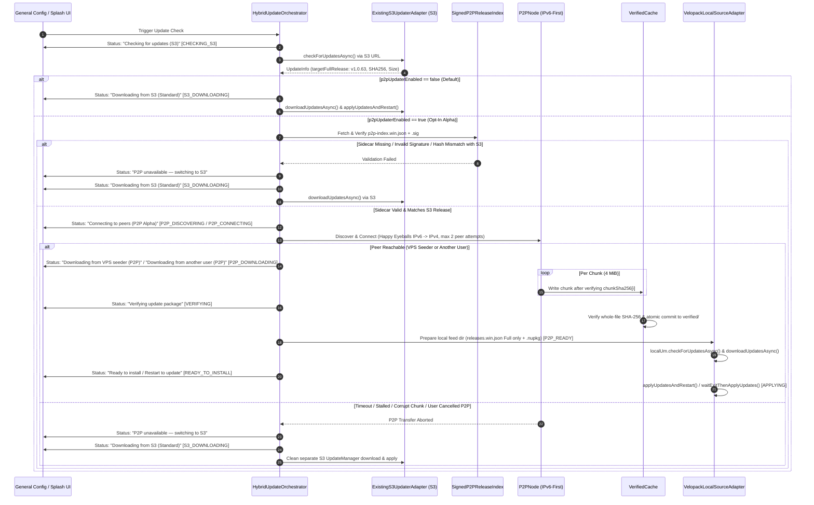

# Arsitektur DecentraUpdate (Public Alpha: Hybrid S3 + IPv6-First P2P)

Dokumen ini menjelaskan arsitektur teknis untuk fitur eksperimental **`Updater with Peer-To-Peer System`** pada aplikasi desktop **SA-CHAOS** (`SA-CHAOS-ELECTRON` + `SA-CHAOS-CONFIG`).

---

## 1. Prinsip Desain & Batas Kepercayaan (Trust Boundary)

1. **S3 Tetap Menjadi Single Source of Truth Pemilihan Versi**:
   - Endpoint resmi `https://updater.sa-chaos.my.id/velopack.php/` (backed oleh CloudHost S3 `https://is3.cloudhost.id/sa-chaos/desktop/updates/`) tetap menjadi satu-satunya otoritas untuk memeriksa ketersediaan versi baru (`releases.win.json`).
   - Peer P2P, VPS seeder, maupun daftar peer **tidak pernah dipercaya** untuk menentukan versi rilis terbaru.
2. **Isolasi Kegagalan (Zero-Impact S3 Fallback)**:
   - Apabila `p2pUpdaterEnabled === false` (default), jalankan 100% jalur `ExistingS3UpdaterAdapter` tanpa memuat atau membuka socket jaringan P2P.
   - Apabila `p2pUpdaterEnabled === true`, kegagalan apa pun pada fase P2P (sidecar tidak ditemukan, signature tidak valid, peer tidak ditemukan, timeout koneksi, kecepatan di bawah batas minimum, hash chunk gagal, atau user mematikan toggle di tengah jalan) akan langsung memicu perpindahan bersih ke `ExistingS3UpdaterAdapter` (S3 standar).
3. **Verifikasi Kriptografis Berlapis**:
   - **Lapis 1 (Authoritative S3 Check)**: `UpdateManager` S3 membaca `releases.win.json` via HTTPS.
   - **Lapis 2 (Signed P2P Sidecar Index)**: Mengunduh `p2p-index.win.json` dan `p2p-index.win.sig` dari endpoint HTTPS resmi, memverifikasi tanda tangan **Ed25519** terhadap canonical JSON (RFC 8785) menggunakan public key publisher yang di-pin di aplikasi, memvalidasi `appId`, `channel`, `arch`, `version`, `sequence` (anti-rollback), dan `expiresAt`.
   - **Lapis 3 (Per-Chunk SHA-256)**: Setiap chunk (`4 MiB`) yang diterima dari peer diverifikasi SHA-256-nya sebelum ditulis ke file `.part` di direktori `staging/`.
   - **Lapis 4 (Whole-File SHA-256 & Cross-Check)**: Setelah seluruh chunk selesai, file dihitung ulang SHA-256 dan ukuran byte-nya, dicocokkan dengan `SignedP2PReleaseIndex` **dan** `targetFullRelease.SHA256` dari `releases.win.json` S3, lalu di-commit secara atomik ke `verified/`.

---

## 2. Diagram Komponen Arsitektur

---

## 3. Sequence Diagram: Alur Update S3 vs P2P & Fallback Otomatis

---

## 4. State Machine & Anggaran Waktu (Timeouts & Budgets)

### State Machine Resmi
`HybridUpdateOrchestrator` hanya mengizinkan satu proses update berjalan pada satu waktu (*single-flight lock*) dengan state berikut:
- `IDLE`: Belum ada operasi update.
- `CHECKING_S3`: Mengecek `releases.win.json` melalui endpoint S3 resmi.
- `NO_UPDATE`: Versi aplikasi sudah paling baru.
- `P2P_DISCOVERING`: Mengambil/memvalidasi `SignedP2PReleaseIndex` dan mencari kandidat peer (VPS bootstrap, PEX, persisted peers, LAN).
- `P2P_CONNECTING`: Mencoba koneksi TCP dual-stack (Happy Eyeballs IPv6 terlebih dahulu, fallback IPv4).
- `P2P_DOWNLOADING`: Mengunduh chunk paket `.nupkg` dari peer atau VPS seeder.
- `VERIFYING`: Memverifikasi SHA-256 file penuh dan mencocokkan dengan metadata resmi S3.
- `P2P_READY`: Menyusun direktori local feed Velopack dan melakukan staging ke direktori `packages` Velopack melalui `VelopackLocalSourceAdapter`.
- `S3_DOWNLOADING`: Mengunduh update melalui jalur S3 standar (baik saat P2P OFF maupun saat fallback dari P2P).
- `READY_TO_INSTALL`: Paket siap dipasang ketika aplikasi restart.
- `APPLYING`: Menjalankan `applyUpdatesAndRestart` / `waitExitThenApplyUpdates`.
- `FAILED`: Kegagalan fatal (hanya jika S3 juga gagal).
- `CANCELLED`: Dibatalkan saat aplikasi ditutup.

### Budget Waktu Default (Konfigurabel)
| Parameter | Default | Keterangan |
|---|---|---|
| `discoveryTimeoutMs` | `6000` ms (6 dtk) | Batas waktu pencarian peer dan fetch sidecar |
| `connectTimeoutMs` | `8000` ms (8 dtk) | Batas waktu koneksi TCP per percobaan peer (IPv6 staggered 2.5 dtk sebelum IPv4) |
| `firstByteTimeoutMs` | `10000` ms (10 dtk) | Batas waktu menunggu byte pertama chunk dari peer |
| `idleTimeoutMs` | `20000` ms (20 dtk) | Batas waktu stream macet tanpa byte baru (bukan timeout total 30 detik agar file ~170 MB tetap bisa selesai) |
| `minSpeedBytesPerSec` | `65536` B/s (64 KB/s) | Kecepatan minimum rata-rata selama jendela evaluasi (15 dtk); di bawah ini dianggap lambat dan fallback ke S3 |
| `maxPeerAttempts` | `2` | Maksimal percobaan peer berbeda sebelum otomatis beralih ke S3 |

---

## 5. Penanganan Khusus Integrasi Velopack (`velopack@0.0.89`)

Hasil audit pada `c:\SA-Chaos\SA-CHAOS-ELECTRON\node_modules\velopack` menunjukkan:
1. Binding JavaScript `velopack@0.0.89` menyediakan class `UpdateManager` dengan method `setUrlOrPath(urlOrPath)`, `checkForUpdatesAsync()`, `downloadUpdatesAsync(toDownload, progress)`, `applyUpdatesAndRestart(toApply, restartArgs)`, dan `waitExitThenApplyUpdates(toApply, silent, restart, restartArgs)`.
2. Di balik layar, `Velopack.js` memanggil binary `Vfusion.exe` dengan argumen `--url <urlOrPath>`, yang mendukung baik URL HTTP/HTTPS maupun path direktori lokal.
3. Agar paket `Full` dari P2P tidak tercampur dengan artefak `Delta` di S3, `VelopackLocalSourceAdapter`:
   - Membuat direktori khusus `%APPDATA%\SA-CHAOS\data\p2p-cache\local-feed\<version>\`.
   - Menyalin/menautkan file `SA-CHAOS-<version>-full.nupkg` yang sudah terverifikasi SHA-256 ke dalam direktori tersebut.
   - Menulis `releases.win.json` lokal yang **hanya** berisi entri `Type: "Full"` untuk versi tersebut (beserta `RELEASES` untuk kompatibilitas mundur).
   - Membuat instance `new UpdateManager()` baru yang terpisah dari instance S3, memanggil `localUm.setUrlOrPath(localFeedDir)`, lalu `const localInfo = await localUm.checkForUpdatesAsync()`, `await localUm.downloadUpdatesAsync(localInfo.targetFullRelease, progress)`, dan menyerahkan `localInfo.targetFullRelease` milik `localUm` ke `applyUpdatesAndRestart` / `waitExitThenApplyUpdates`.
   - Tidak pernah mencampur objek `UpdateInfo` dari instance S3 dengan instance lokal.

---

## 6. Kill Switch
- Mengubah `p2pUpdaterEnabled = false` di menu **General Config** (atau melalui file konfigurasi lokal) langsung memutus semua stream P2P aktif, menghentikan listener/seeder P2P dalam hitungan milidetik, dan jika sedang mengunduh update, langsung mengalihkan unduhan ke S3 tanpa menghentikan proses update.
